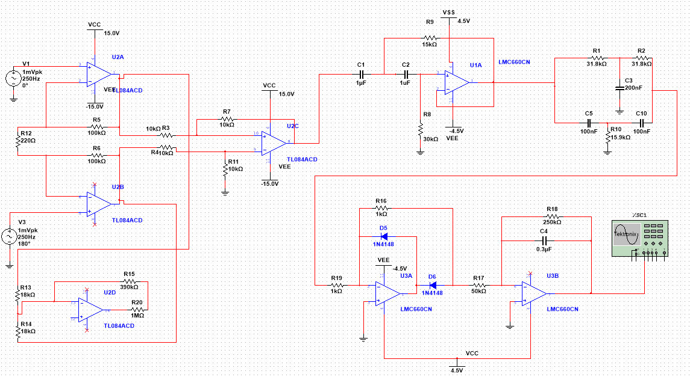
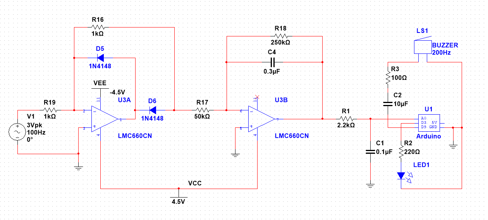

# Surface-EMG Human–Machine Interface

A breadboard prototype that turns surface EMG (sEMG) from the upper arm into audio-visual and
mechanical outputs. An analogue front end extracts the muscle-activity envelope, and an Arduino
maps it to a 10-LED bar, a servo angle and a buzzer pitch.

One-week team project (four members), UCL Department of Electronic and Electrical Engineering,
January 2026. Designed and simulated in NI Multisim, then built and tested on breadboard.

## Electrode placement

Three surface electrodes are used:

- **Two recording electrodes** placed one above the other along the upper arm, over the
  muscle belly near the top of the arm where muscle bulk is largest. They are aligned with
  the muscle fibres and form one differential channel.
- **One reference electrode** on the lower upper arm near the elbow crease, where there is
  little muscle, so it picks up mainly common-mode interference rather than EMG.

The electrodes connect through a 3.5 mm TRS cable: tip and ring go to the two
instrumentation-amplifier inputs, and the sleeve (reference electrode) is driven by the
driven-right-leg circuit.

## Signal chain

```
Electrodes → Instrumentation amplifier → High-pass → 50 Hz notch → Precision rectifier → Integrator low-pass → Arduino ADC → LED bar / servo / buzzer
                     ↑
           Driven-right-leg reference
```

| Stage | Circuit | Key values | Purpose |
|---|---|---|---|
| Instrumentation amplifier | Three-op-amp INA (TL084, ±15 V) | R5 = R6 = 100 kΩ, R12 = 220 Ω, difference stage 10 kΩ; gain ≈ 1 + 2·100k/220 ≈ 910 (≈ 59 dB) | Amplify the µV-to-mV differential signal with high input impedance and common-mode rejection |
| Driven right leg | Inverting amplifier on the common-mode voltage (U2D) | R13 = R14 = 18 kΩ average the two input-buffer outputs; the reference electrode sits between R15 = 390 kΩ (to the inverting input) and R20 = 1 MΩ (to the op-amp output) | Drive the reference electrode with the inverted common-mode signal to suppress mains pickup; R20 limits the current into the body |
| High-pass filter | 2nd-order Sallen–Key, unity gain (LMC660, ±4.5 V) | C1 = C2 = 1 µF, R8 = 30 kΩ, R9 = 15 kΩ; f_c ≈ 7.5 Hz | Remove DC offset and motion drift below the sEMG band (~10–500 Hz) |
| Notch filter | Passive twin-T | R = 31.8 kΩ, C = 100 nF (R/2 = 15.9 kΩ, 2C = 200 nF); f₀ ≈ 50 Hz | Suppress mains interference |
| Precision rectifier | Inverting half-wave rectifier | R16 = R19 = 1 kΩ, 1N4148 diodes | Take the absolute value of the signal without diode drop |
| Integrator low-pass | Inverting amplifier with RC feedback | R17 = 50 kΩ, R18 = 250 kΩ, C4 = 0.3 µF; gain 5, f_c ≈ 2.1 Hz | Average the rectified signal into a mean-absolute-value envelope that follows muscle activation (1–2 Hz) |
| ADC input | RC low-pass | 2.2 kΩ, 0.1 µF; f_c ≈ 720 Hz | Smooth the input to the Arduino ADC |

The second inverting stage cancels the rectifier's inversion, so the envelope is positive and
rises with muscle activity.





The output-stage schematic is a simplified simulation model; the pin assignment used on the
breadboard is the one in the Arduino code below.

## Arduino control

`emg_hmi_controller/emg_hmi_controller.ino`

1. **Self-test:** flashes all LEDs and sweeps the servo.
2. **Calibration:** records the resting envelope for 5 s to set each user's baseline range,
   since signal amplitude differs between people and electrode placements. If the range is too
   narrow, a default range is used.
3. **Control loop:** an 8-sample moving average smooths the ADC reading, which is mapped to
   - the number of lit LEDs (0–10),
   - the servo angle (0–180°),
   - the buzzer pitch (400–1500 Hz), active only above the resting minimum.

| Output | Pin |
|---|---|
| EMG envelope input | A0 |
| LED bar | 2–10, 13 |
| Servo | 11 (PWM) |
| Buzzer | 12 |

## Results

- The analogue chain was simulated in Multisim with two 1 mV, 250 Hz antiphase sources
  (a 2 mV differential input) before building it on breadboard.
- On the breadboard, after the 5 s per-user calibration, muscle contractions were detected
  reliably for every tester.
- The low-pass cut-off trades smoothness against response speed: a lower cut-off gives a steadier
  envelope but a slower response to a contraction.

## Safety

The system was disconnected from mains and run from batteries whenever electrodes were attached
to a person.
